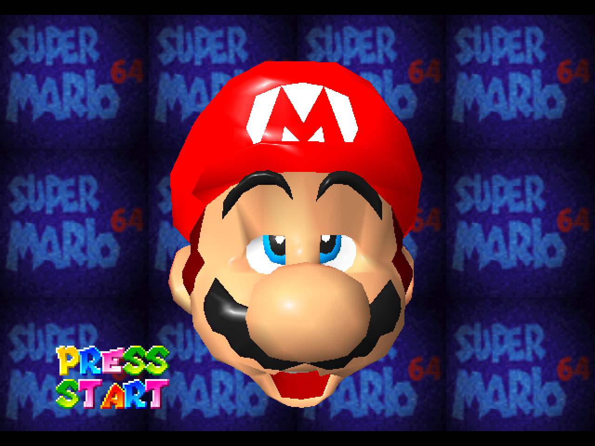
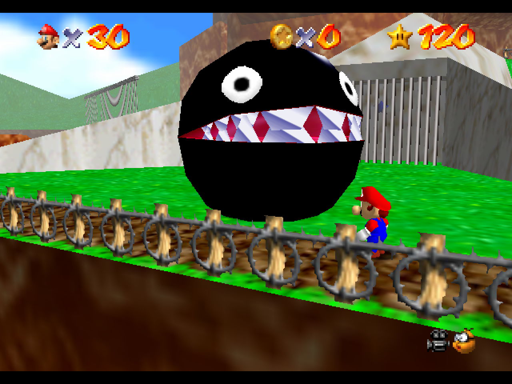
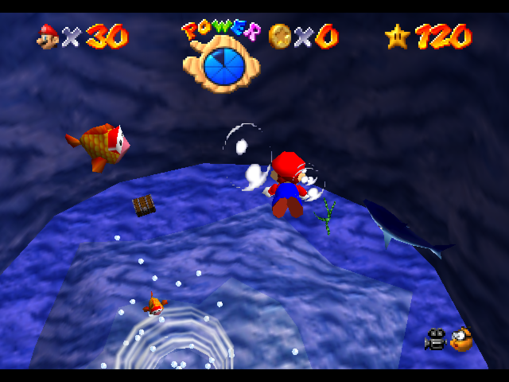
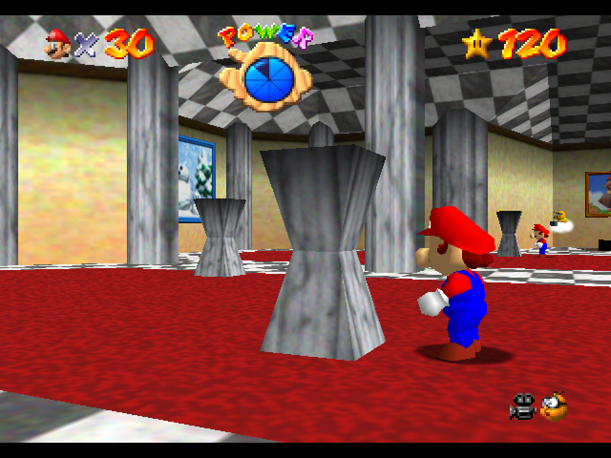
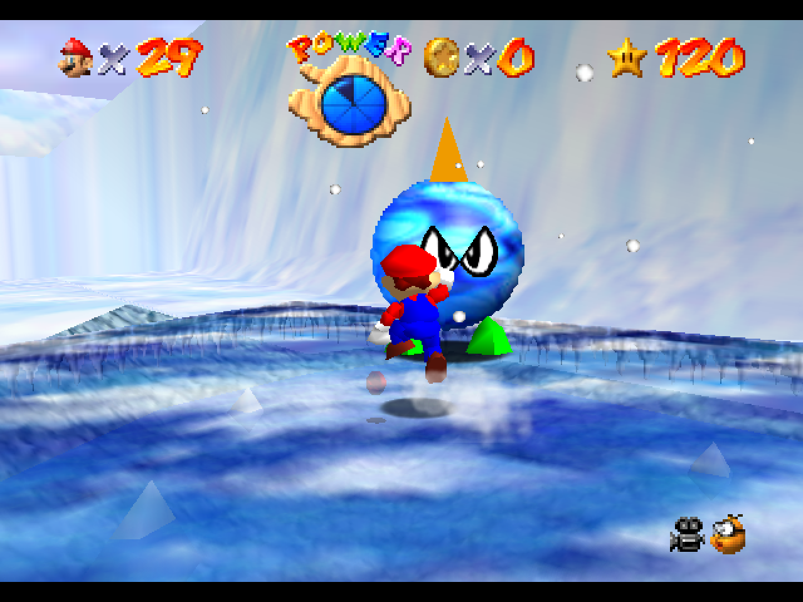
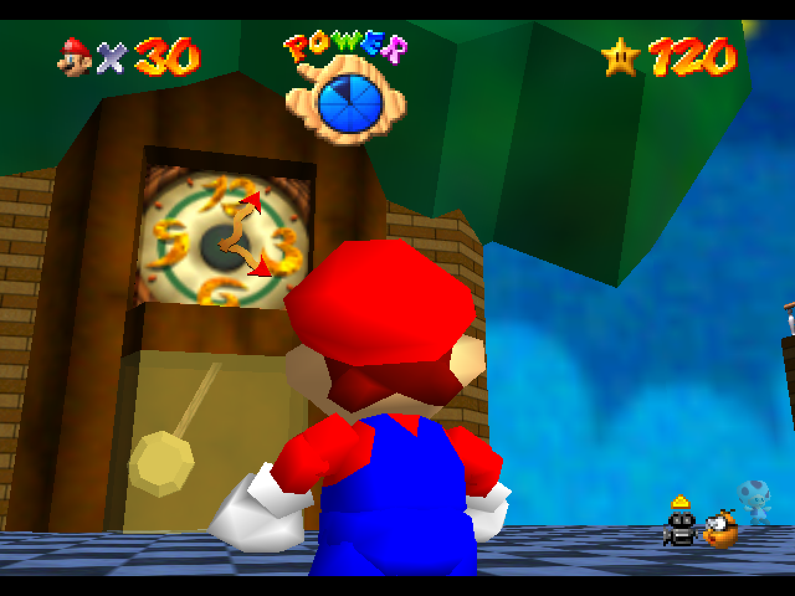
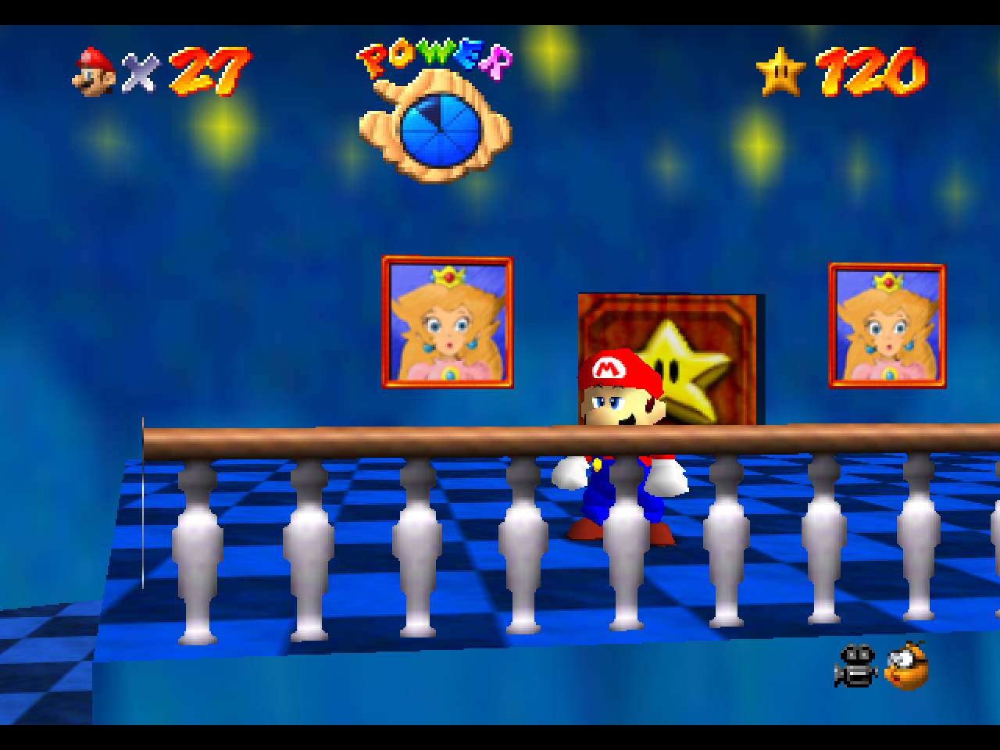
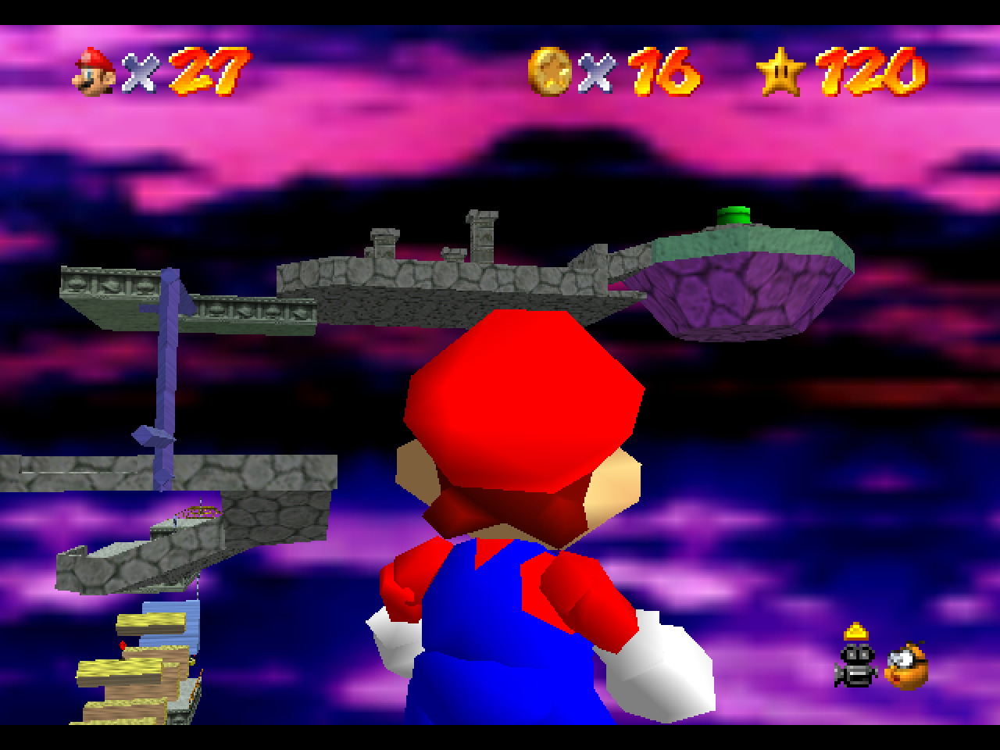

# Super Mario 64 for the Sega Dreamcast (updated 2026/08/24)

Now with hardware-mixed audio, 24-bit color framebuffer, raw PowerVR Fast 3D backend with significant N64-accuracy enhancements and all around improved performance.

This is an update to the original 2020 mrneo240 Dreamcast port of Super Mario 64. It addresses the audio-visual issues that were present and adds VMU saving.










This repo does not include all assets necessary for compiling the game.
A prior copy of the game is required to extract the assets. Specifically you will need to provide the US version.

## 60 fps, FSAA, sound and the debug menu

- **60 fps.** The game logic still runs at 30 Hz. Each step is drawn twice: once interpolated
  halfway from the previous step, then exact. When the interpolated picture is late, the exact
  one is dropped, so the game never slows down.
- **FSAA.** The PowerVR renders 1280 pixels wide and the video output filters it down to 640. It
  is on except in the scenes whose fill does not fit 60 fps with it (water, lava and a few heavy
  ones; `DC_FSAA_OFF_SCENES` in `src/pc/gfx/gfx_pvr.c`).
- **Renderer.** Display lists are compiled once into native PowerVR-ready meshes and drawn
  through [enDjinn](https://github.com/dfchil/enDjinn)'s render lists. The hot loops are SH4
  assembly, and the hot code and data are pinned to fixed cache sets (checked after the link).
  Screen transitions are polygon masks, and fades use the PowerVR's fog.
- **Sound.** Music and sound effects play on the AICA's own ARM7 through
  [AICAflow](https://github.com/dfchil/AICAflow), with no sequencer running on the SH4. The
  songs and sounds are recorded from the game's original audio driver on the build machine and
  converted with [AICAforge](https://github.com/dfchil/AICAforge) when you build. They are packed
  per scene and loaded with the level, and the N64's reverb runs on the AICA's DSP.
- **Rumble.** A Puru Puru pack in the controller rumbles where the Shindou version of the game
  rumbles its Rumble Pak: landings, hits, fall damage, pipes, Whomp's and Bowser's steps and
  more. Only those calls are taken from that version; its gameplay changes are not. A TAS replay
  and the title's demos do not rumble.
- **Debug menu.** Hold both triggers and press Up+X+Y. It switches the frame rate (60 fps that
  drops a late frame, which is the default; 60 fps that slows down instead; or 30 fps), FSAA
  (curated, on, off, or a button that toggles it), 640x480 or 320x240 (240p), the reverb, and a
  frame-rate overlay. It also has two rows for the TAS below. In Flycast on a keyboard, many
  keyboards cannot hold the default keys for it (F, V, S, D and Up) at once: map the triggers to
  other keys, or use a gamepad.
- **TAS replay and level select.** The game logic is built without float shortcuts, so it computes
  what the N64 does and an N64 tool-assisted speedrun plays in sync on the Dreamcast. *TAS replay*
  plays the whole 120-star run, from the intro to The End, or one section of it (a star or two, or
  a Bowser fight), from the next level change. *Level select* puts you in any star's level, with
  the run's save and state from when it went there, and the controller plays. Both play with the
  run's save and leave the one on your VMU alone. *Off* in both rows as the menu closes (or A on
  *Off*) gives the pad back, reloads your VMU save and returns to the title; so does the end of the
  whole run, ten seconds after The End. The movie is
  [TASVideos](https://tasvideos.org)' "120 stars in 1:14:04" by Alexpalix1, atmpas, Bret,
  ChouxZi3, circumark, Crackhex, CSZ, DyllonStej, elbertito, Eru, FeijoadaMolhada, fifdspence,
  Frame, Kieran, Krithalith, Manama, Mickey, Plush, roblox8192, sm64expert, snark, Superdavo0001,
  tesserakt, ToT, tjk, Why and Xander (`tas/tas.m64`); `tas/tas_slices.bin` holds the game state at
  each of its level changes. Both go on the disc's `/afx`.

## Building for Sega Dreamcast
# Just use the CDI builder found here: https://colab.research.google.com/drive/1TZtuI3QbSiIr6uFsgaGUr-7At5fwLdN5

Nobody follows directions anyway. If you want to build it the real way, I'll leave the rest of the docs, but I know they'll go unread.

**Fixed textures live in the psp/textures/ folder. copy these into textures/, overwrite the extracted ones, and rebuild**

1. Install the Dreamcast toolchain https://github.com/KallistiOS/KallistiOS/tree/master/utils/dc-chain, and KallistiOS 2.3.0 or newer.
   `environ.sh` builds with `-m4-single`, which needs a KallistiOS built the same way (the default).
2. Install [sh4zam](https://github.com/gyrovorbis/sh4zam) 0.10 into KallistiOS's addons
   (`$KOS_BASE/addons/include/sh4zam`, `libsh4zam.a`).
3. Install python3 and a C compiler for the build machine. The songs and sounds are made by
   tools that run there.
4. Clone with the submodules: `git clone --recursive`, or `git submodule update --init` in an
   existing checkout.
5. Place a Super Mario 64 ROM called `baserom.<VERSION>.z64` into the repository's root directory for asset extraction, where `VERSION` can be `us`, `jp`, or `eu`. **Note: Only US supported**
6. Run `make TARGET_DC=1` (`gmake` on macOS). The first build also records and converts every
   song and sound into `build/us_dc/afx_stage/afx`, which takes a few minutes.
7. To make a CDI, run `make TARGET_DC=1 cdi`. You need `mkdcdisc` installed and on your path. The
   songs and sounds go on the disc as `/afx`.
8. To load the ELF with dc-tool / dc-load instead, build with `FOR_DCLOAD=1`: the game then
   reads the songs and sounds from this machine's `build/us_dc/afx_stage/afx` through dcload.


## Project Structure

```
sm64
├── actors: object behaviors, geo layout, and display lists
├── asm: handwritten assembly code, rom header
│   └── non_matchings: asm for non-matching sections
├── assets: animation and demo data
│   ├── anims: animation data
│   └── demos: demo data
├── bin: C files for ordering display lists and textures
├── build: output directory
├── data: behavior scripts, misc. data
├── doxygen: documentation infrastructure
├── enhancements: example source modifications
├── include: header files
├── levels: level scripts, geo layout, and display lists
├── lib: SDK library code
├── rsp: audio and Fast3D RSP assembly code
├── sound: sequences, sound samples, and sound banks
├── src: C source code for game
│   ├── audio: audio code
│   ├── buffers: stacks, heaps, and task buffers
│   ├── engine: script processing engines and utils
│   ├── game: behaviors and rest of game source
│   ├── goddard: Mario intro screen
│   ├── menu: title screen and file, act, and debug level selection menus
│   └── pc: port code, audio and video renderer
├── text: dialog, level names, act names
├── textures: skybox and generic texture data
└── tools: build tools
```

## Contributing

Pull requests are welcome. For major changes, please open an issue first to
discuss what you would like to change.

Run `clang-format` on your code to ensure it meets the project's coding standards.
